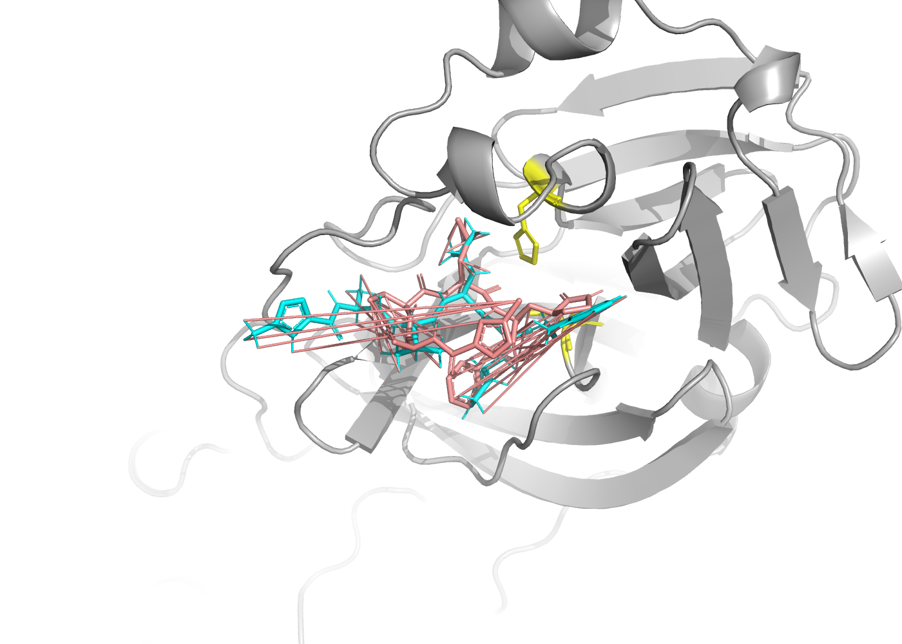

# Phytochemicals vs SARS-CoV-2 main protease: a reproducible docking workflow

[](LICENSE)


[](https://github.com/Ishitta-Sarkar/covid-mpro-phytochemical-docking/actions)

Structure-based docking of five plant-derived compounds against the **SARS-CoV-2 main protease (Mpro, 3CLpro)**, the enzyme that cuts the viral polyproteins. The receptor is the 2.16 Å crystal structure [PDB 6LU7](https://www.rcsb.org/structure/6LU7) (Jin et al., Nature, 2020). This repository is the computational part of my B.Tech final-year project.

Every score below comes from one scripted AutoDock Vina 1.2.7 run (exhaustiveness 16, seed 42, 4 CPU threads). The raw logs are in `docking/logs/`.

## Question

For this fixed protocol, how do five phytochemicals rank against Mpro, and can the same protocol reproduce the co-crystallised inhibitor pose?

## Target and ligands

**Receptor.** SARS-CoV-2 Mpro, chain A of PDB 6LU7 (306 residues, downloaded from RCSB). Waters and the inhibitor are removed. Meeko 0.8.0 builds the rigid PDBQT from residue templates (polar hydrogens and Gasteiger charges).

**Co-crystallised inhibitor.** In the current 6LU7 file the inhibitor historically called N3 is chain C, not a single residue named N3: `02J–ALA–VAL–LEU–PJE–010` (formula of the connected molecule, C<sub>35</sub>H<sub>48</sub>N<sub>6</sub>O<sub>8</sub>). A `LINK` record places Cys145 SG 1.79 Å from PJE C20. That bond is left out of the ligand because Vina has no covalent term. Bond orders for 02J, PJE and 010 are taken from the RCSB chemical component dictionaries in `data/ccd/`. PJE C20=C21 is a double bond there, and the deposited distance is 1.32 Å, so the docked ligand is the unsaturated inhibitor rather than a saturated adduct. Heavy-atom coordinates are the crystallographic ones.

**Screening set.** One PubChem 3D conformer per compound. No tautomer or protomer enumeration.

| Ligand | Class | PubChem CID | Formula in the 3D record |
|---|---|---|---|
| Quercetin | Flavonoid | [5280343](https://pubchem.ncbi.nlm.nih.gov/compound/5280343) | C<sub>15</sub>H<sub>10</sub>O<sub>7</sub> |
| Curcumin | Polyphenol | [969516](https://pubchem.ncbi.nlm.nih.gov/compound/969516) | C<sub>21</sub>H<sub>20</sub>O<sub>6</sub> |
| Kaempferol | Flavonoid | [5280863](https://pubchem.ncbi.nlm.nih.gov/compound/5280863) | C<sub>15</sub>H<sub>10</sub>O<sub>6</sub> |
| Andrographolide | Diterpenoid lactone | [5318517](https://pubchem.ncbi.nlm.nih.gov/compound/5318517) | C<sub>20</sub>H<sub>30</sub>O<sub>5</sub> |
| Berberine | Alkaloid | [2353](https://pubchem.ncbi.nlm.nih.gov/compound/2353) | C<sub>20</sub>H<sub>18</sub>NO<sub>4</sub><sup>+</sup> |

Berberine is the PubChem cation (formal charge +1), not a chloride salt.

## Workflow

```text
RCSB PDB 6LU7 ──► chain A, Meeko receptor PDBQT
               └► chain C assembled as N3 (covalent C–S bond omitted)
PubChem 3D SDF ──► RDKit sanitisation, Meeko ligand PDBQT
                 ▼
  Same cubic search box for every ligand (see docking/vina_config.txt)
                 ▼
  Validation: score the crystal N3 pose, then re-dock it (seed 42)
                 ▼
  Dock the five phytochemicals ──► best-pose score, H-bond geometry, figure
```

### Search box

The box is a **30 Å cube** centred on the heavy-atom centroid of the 49 crystallographic inhibitor atoms:

| Parameter | Value |
|---|---|
| centre (x, y, z) | −10.729, 12.418, 68.816 |
| size | 30 × 30 × 30 Å |
| exhaustiveness | 16 |
| num_modes | 9 |
| energy_range | 3 kcal/mol |
| min_rmsd between modes | 1 Å |
| seed | 42 |
| CPU threads | 4 |

The edge is the smallest even number of angstroms that is at least 22 and that still leaves 4 Å between the furthest crystal atom and the face of the box (the long axis of the inhibitor reaches 10.96 Å from the centroid). His41 CA is 10.18 Å from the centre and Cys145 SG is 6.55 Å from it, so both catalytic residues sit inside the box. The centre is the inhibitor centroid, not the midpoint of the dyad: the dyad is at the warhead end of a long ligand.

### How the redocking RMSD is computed

Heavy atoms only, in the crystal frame, **without** superimposing the two poses. RDKit graph automorphisms are tried so that equivalent atoms (the phenyl flip and the gem-dimethyl groups; 8 automorphisms for this molecule) can be matched. The identity mapping is always included. The direct RMSD is reported next to the symmetry-corrected value. A round-trip check confirms that writing the crystal conformer to PDBQT and reading it back moves the heavy atoms by 0.000 Å before docking starts.

Hydrogen bonds use the hydrogens already present in the Meeko PDBQT files. A bond is counted when the H···A distance is ≤ 2.5 Å and the D–H···A angle is ≥ 120° (Baker and Hubbard), with N or O as donor and acceptor. A contact residue has any heavy atom within 4.0 Å of the ligand.

## Results

### Redocking of the co-crystallised inhibitor

| Quantity | Value |
|---|---|
| Heavy-atom RMSD, symmetry-corrected | **7.266 Å** |
| Heavy-atom RMSD, atom order preserved | 7.295 Å |
| Vina score of the docked pose | −8.520 kcal/mol |
| Vina score of the crystallographic coordinates (`--score_only`) | −3.470 kcal/mol |
| PJE C20–Cys145 SG distance, crystal | 1.793 Å |
| PJE C20–Cys145 SG distance, top docked pose | 5.121 Å |
| Closest heavy-atom contact, top docked pose | 2.945 Å |

**7.266 Å does not meet the usual 2 Å pose-reproduction criterion.** The deposited coordinates include a covalent C–S contact. Vina treats that contact as a clash, scores the crystal pose at only −3.470 kcal/mol, and the search moves the warhead carbon 5.121 Å away from the sulfur to a pose it scores at −8.520 kcal/mol. The two heavy-atom RMSDs differ by 0.029 Å, so the failure is not an atom-matching artefact. Cyan in the figure is the crystal inhibitor; salmon is the top Vina pose; yellow is His41 and Cys145.



### Phytochemical ranking

Same receptor, same box, same seed. Rank 1 is the most negative score.

| Rank | Ligand | Vina score (kcal/mol) | Active torsions |
|---|---|---|---|
| 1 | Kaempferol | −7.745 | 5 |
| 2 | Berberine | −7.679 | 2 |
| 3 | Quercetin | −7.518 | 6 |
| 4 | Curcumin | −6.910 | 10 |
| 5 | Andrographolide | −6.883 | 6 |

The five scores span 0.862 kcal/mol. That is a ranking under this protocol, not evidence that the compounds are meaningfully separated.


Kaempferol's top pose makes two hydrogen bonds that pass the geometric filter: a ligand oxygen donates to Gln189 OE1 (H···A 1.912 Å, angle 164.7°) and His163 NE2 donates to a ligand oxygen (2.463 Å, 129.5°). Heavy atoms of His41 (3.945 Å) and Cys145 (3.625 Å) are inside the 4.0 Å shell, together with His163, His164, Met165, Glu166, Leu141, Ser144, Asp187, Arg188, Gln189, Met49, Tyr54 and Phe140. The full tables are `results/hydrogen_bonds.csv` and `results/residue_contacts.csv`.

> **What these numbers are.** A Vina score is an empirical docking score in kcal/mol units. Vina's own log calls the single-point value an "Estimated Free Energy of Binding". That label is not a measured binding affinity, a dissociation constant, or a physics-based free energy. The scores can be used to rank poses and compounds **inside this run**. They are not evidence that any compound inhibits Mpro.

## Reproduce

```bash
conda env create -f environment.yml
conda activate mpro-docking
bash docking/run_docking.sh
python src/plot_results.py
python src/main.py
pytest
```

`docking/run_docking.sh` downloads PDB 6LU7 and the five PubChem SDFs if they are not already in `structures/raw/`, writes the receptor and ligand PDBQT files, runs Vina, and rewrites the tables and `results/vina_scores.png`. Pass `--refresh` to download the sources again. The published logs, poses and checksums in `results/run_metadata.json` are the run from 2026-11-24 on Linux x86_64 with the versions pinned in `environment.yml` (Vina binary `f458505-mod`).

Changing the thread count can change a Vina search even with the same seed. This run fixes `--cpu 4`.

CI (`.github/workflows/ci.yml`) lints the Python and runs pytest. It does not launch Vina. The tests check ligand assembly, the RMSD implementation (including that it does not superimpose poses), the log parser, and that `data/docking_results.csv` matches the committed logs.

## Repository layout

```text
data/ligands.csv                 PubChem CIDs
data/docking_results.csv         best-pose scores from the published run
data/ccd/                        RCSB chemical component dictionaries used for N3
docking/vina_config.txt          box, exhaustiveness, seed
docking/run_docking.sh           end-to-end script
docking/logs/                    Vina stdout, including the score-only control
docking/overlay_n3.pml           PyMOL session for the redocking figure
structures/raw/                  downloaded PDB and PubChem SDFs
structures/receptor/             chain A PDB and Meeko PDBQT
structures/ligands/              prepared PDBQT files and the crystal N3 SDF
structures/poses/                Vina pose PDBQT files
src/mpro_docking/                fetch, preparation, Vina, RMSD, tables
src/plot_results.py              write results/vina_scores.png
tests/                           pytest, including a fixture of chain C
results/                         tables, metadata, figures
```

## Limitations

- The redocking test **failed** the 2 Å threshold for the reason given above. A non-covalent docking score on a covalent crystal structure is a poor pose-reproduction test. It is reported because that is what this protocol does, not because the pose was recovered.
- The receptor is rigid, including the Cys145 side chain in its covalent-complex geometry. Histidine tautomer and protonation states come from Meeko templates, not from a constant-pH calculation.
- Each phytochemical is a single PubChem 3D conformer. Curcumin tautomerism, flavonoid protonation and alternative ring conformers were not searched.
- One random seed was used. The run is repeatable with that seed and 4 threads; it is not a consensus over seeds.
- Five compounds is a demonstration set, not a screened library. No ADMET filter and no experimental assay is included.
- No molecular-dynamics refinement and no free-energy method. Those would be separate calculations, not a reinterpretation of the Vina scores.
- Scores can shift with the Vina build or the CPU architecture. The build used here is recorded in `results/run_metadata.json`.

## Roadmap

- [x] Redock the co-crystallised inhibitor and report the RMSD that the run actually produced (7.266 Å, above 2 Å)
- [ ] A non-covalent positive control on a structure that is not a covalent adduct (for example nirmatrelvir / PDB 7SI9)
- [ ] 100 ns GROMACS trajectories of the top complexes: RMSD, RMSF, hydrogen bonds
- [ ] A larger natural-product set (IMPPAT or COCONUT) with an explicit ADMET filter

## References

- Jin Z, Du X, Xu Y, et al. Structure of Mpro from SARS-CoV-2 and discovery of its inhibitors. *Nature*. 2020;582:289-293. doi:10.1038/s41586-020-2223-y. Structure 6LU7.
- Trott O, Olson AJ. AutoDock Vina: improving the speed and accuracy of docking with a new scoring function, efficient optimization, and multithreading. *J Comput Chem*. 2010;31:455-461. doi:10.1002/jcc.21334.
- Eberhardt J, Santos-Martins D, Tillack AF, Forli S. AutoDock Vina 1.2.0: new docking methods, expanded force field, and Python bindings. *J Chem Inf Model*. 2021;61:3891-3898. doi:10.1021/acs.jcim.1c00203.
- Baker EN, Hubbard RE. Hydrogen bonding in globular proteins. *Prog Biophys Mol Biol*. 1984;44:97-179.
- Chemical component definitions and coordinates: [RCSB PDB](https://www.rcsb.org/) entry 6LU7. Ligand coordinates: [PubChem](https://pubchem.ncbi.nlm.nih.gov/).
- Ligand and receptor PDBQT files: Meeko 0.8.0 (Forli laboratory). Open Babel 3.2.1 was used to write PDB copies of the ligand SDFs. RDKit 2026.03.1 was used for sanitisation, conformer handling and RMSD.

## Citation

See [CITATION.cff](CITATION.cff).

## Author

Ishitta Sarkar · [ORCID 0009-0008-1028-6010](https://orcid.org/0009-0008-1028-6010)

B.Tech Biotechnology (Honours), Dr. A.P.J. Abdul Kalam Technical University, 2022–2026.

MIT License.
