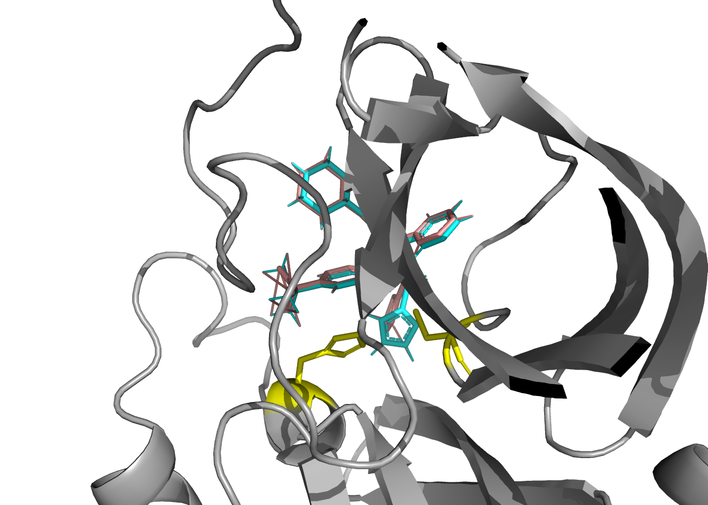
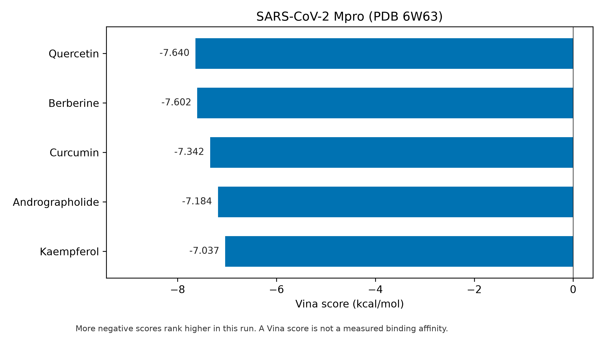
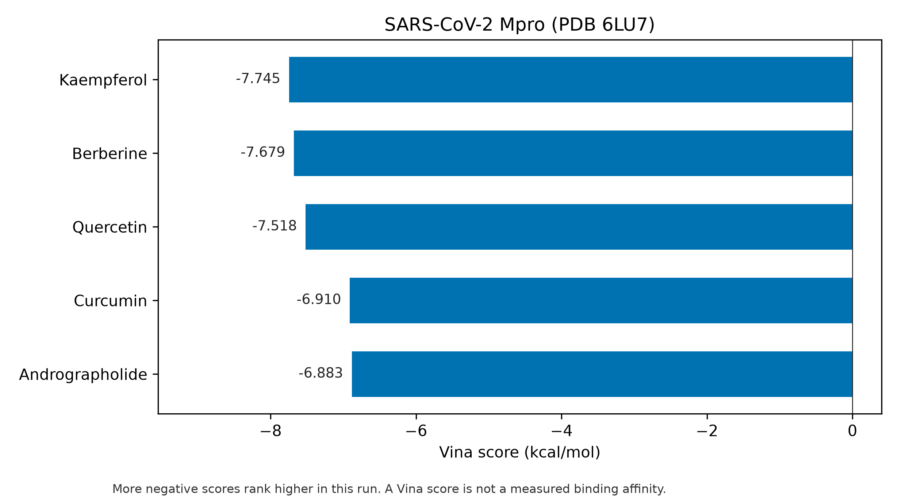

# Phytochemicals vs SARS-CoV-2 main protease: a reproducible docking workflow

[](LICENSE)


[](https://github.com/Ishitta-Sarkar/covid-mpro-phytochemical-docking/actions)

Structure-based docking of five plant-derived compounds against the **SARS-CoV-2 main protease (Mpro, 3CLpro)**, the enzyme that cuts the viral polyproteins. This repository is the computational part of my B.Tech final-year project.

The pose protocol is checked on [PDB 6W63](https://www.rcsb.org/structure/6W63), a 2.10 Å complex with the non-covalent inhibitor X77. [PDB 6LU7](https://www.rcsb.org/structure/6LU7) (Jin et al., Nature, 2020) is kept as a covalent-complex negative control: standard Vina cannot represent the Cys145–inhibitor bond, so that redock is not used to claim the protocol recovers crystal poses. The five phytochemicals were docked into both receptors. Every score below is from those scripted AutoDock Vina 1.2.7 runs (exhaustiveness 16, seed 42, 4 CPU threads). The raw logs are in `docking/logs/`.

## Question

For this fixed protocol, does redocking recover a non-covalent crystal pose, and how do five phytochemicals rank on that receptor and on the covalent 6LU7 complex?

## Target and ligands

**Receptor.** SARS-CoV-2 Mpro, chain A of PDB 6LU7 (306 residues, downloaded from RCSB). Waters and the inhibitor are removed. Meeko 0.8.0 builds the rigid PDBQT from residue templates (polar hydrogens and Gasteiger charges).

**Co-crystallised inhibitor.** In the current 6LU7 file the inhibitor historically called N3 is chain C, not a single residue named N3: `02J–ALA–VAL–LEU–PJE–010` (formula of the connected molecule, C<sub>35</sub>H<sub>48</sub>N<sub>6</sub>O<sub>8</sub>). A `LINK` record places Cys145 SG 1.79 Å from PJE C20. That bond is left out of the ligand because Vina has no covalent term. Bond orders for 02J, PJE and 010 are taken from the RCSB chemical component dictionaries in `data/ccd/`. PJE C20=C21 is a double bond there, and the deposited distance is 1.32 Å, so the docked ligand is the unsaturated inhibitor rather than a saturated adduct. Heavy-atom coordinates are the crystallographic ones.

**Screening set.** One PubChem 3D conformer per compound. No tautomer or protomer enumeration.

| Ligand | Class | PubChem CID | Formula in the 3D record |
|---|---|---|---|
| Quercetin | Flavonoid | [5280343](https://pubchem.ncbi.nlm.nih.gov/compound/5280343) | C<sub>15</sub>H<sub>10</sub>O<sub>7</sub> |
| Curcumin | Polyphenol | [969516](https://pubchem.ncbi.nlm.nih.gov/compound/969516) | C<sub>21</sub>H<sub>20</sub>O<sub>6</sub> |
| Kaempferol | Flavonoid | [5280863](https://pubchem.ncbi.nlm.nih.gov/compound/5280863) | C<sub>15</sub>H<sub>10</sub>O<sub>6</sub> |
| Andrographolide | Diterpenoid lactone | [5318517](https://pubchem.ncbi.nlm.nih.gov/compound/5318517) | C<sub>20</sub>H<sub>30</sub>O<sub>5</sub> |
| Berberine | Alkaloid | [2353](https://pubchem.ncbi.nlm.nih.gov/compound/2353) | C<sub>20</sub>H<sub>18</sub>NO<sub>4</sub><sup>+</sup> |

Berberine is the PubChem cation (formal charge +1), not a chloride salt.

## Workflow

```text
RCSB PDB 6LU7 ──► chain A, Meeko receptor PDBQT
               └► chain C assembled as N3 (covalent C–S bond omitted)
PubChem 3D SDF ──► RDKit sanitisation, Meeko ligand PDBQT
                 ▼
  Same cubic search box for every ligand (see docking/vina_config.txt)
                 ▼
  Validation: score the crystal N3 pose, then re-dock it (seed 42)
                 ▼
  Dock the five phytochemicals ──► best-pose score, H-bond geometry, figure
```

### Search box

The box is a **30 Å cube** centred on the heavy-atom centroid of the 49 crystallographic inhibitor atoms:

| Parameter | Value |
|---|---|
| centre (x, y, z) | −10.729, 12.418, 68.816 |
| size | 30 × 30 × 30 Å |
| exhaustiveness | 16 |
| num_modes | 9 |
| energy_range | 3 kcal/mol |
| min_rmsd between modes | 1 Å |
| seed | 42 |
| CPU threads | 4 |

The edge is the smallest even number of angstroms that is at least 22 and that still leaves 4 Å between the furthest crystal atom and the face of the box (the long axis of the inhibitor reaches 10.96 Å from the centroid). His41 CA is 10.18 Å from the centre and Cys145 SG is 6.55 Å from it, so both catalytic residues sit inside the box. The centre is the inhibitor centroid, not the midpoint of the dyad: the dyad is at the warhead end of a long ligand.

### How the redocking RMSD is computed

Heavy atoms only, in the crystal frame, **without** superimposing the two poses. RDKit graph automorphisms are tried so that equivalent atoms (the phenyl flip and the gem-dimethyl groups; 8 automorphisms for this molecule) can be matched. The identity mapping is always included. The direct RMSD is reported next to the symmetry-corrected value. A round-trip check confirms that writing the crystal conformer to PDBQT and reading it back moves the heavy atoms by 0.000 Å before docking starts.

Hydrogen bonds use the hydrogens already present in the Meeko PDBQT files. A bond is counted when the H···A distance is ≤ 2.5 Å and the D–H···A angle is ≥ 120° (Baker and Hubbard), with N or O as donor and acceptor. A contact residue has any heavy atom within 4.0 Å of the ligand.

## Results

### Non-covalent redocking control (PDB 6W63, ligand X77)

X77 is residue A 401. The file has no `LINK` record to the protein. The closest crystal heavy-atom contact is 2.796 Å (a normal intermolecular distance, not a bond). The same box rule, centred on the 34 crystal heavy atoms, gives a **22 Å cube** at (−20.096, 18.844, −27.394). Gln306 is missing from the deposit, so the receptor is residues 1–305. X77 has 8 active torsions. The usual criterion used here is a symmetry-corrected heavy-atom RMSD of at most **2 Å**.

| Quantity | Value |
|---|---|
| Heavy-atom RMSD, symmetry-corrected | **0.915 Å** |
| Heavy-atom RMSD, atom order preserved | 1.168 Å |
| Meets the 2 Å criterion | yes (both values) |
| Vina score of the docked pose | −8.507 kcal/mol |
| Vina score of the crystallographic coordinates (`--score_only`) | −8.076 kcal/mol |
| Closest heavy-atom contact, crystal | 2.796 Å |
| Closest heavy-atom contact, top docked pose | 2.843 Å |

The symmetry correction (24 automorphisms, including the tert-butyl group) changes the RMSD from 1.168 Å to 0.915 Å. The search pose and the crystal pose also score within 0.5 kcal/mol of each other. Cyan is the crystal ligand; salmon is the top Vina pose; yellow is His41 and Cys145.



### Covalent-complex negative control (PDB 6LU7, inhibitor N3)

This is not a valid non-covalent docking test. It is reported so the failure mode is explicit.

| Quantity | Value |
|---|---|
| Heavy-atom RMSD, symmetry-corrected | **7.266 Å** |
| Heavy-atom RMSD, atom order preserved | 7.295 Å |
| Meets the 2 Å criterion | no |
| Vina score of the docked pose | −8.520 kcal/mol |
| Vina score of the crystallographic coordinates (`--score_only`) | −3.470 kcal/mol |
| PJE C20–Cys145 SG distance, crystal | 1.793 Å |
| PJE C20–Cys145 SG distance, top docked pose | 5.121 Å |
| Closest heavy-atom contact, top docked pose | 2.945 Å |

**7.266 Å does not meet the 2 Å criterion, and it should not.** The deposited coordinates include a covalent C–S contact. Vina has no covalent term, treats that contact as a clash, scores the crystal pose at only −3.470 kcal/mol, and the search moves the warhead carbon 5.121 Å away from the sulfur to a pose it scores at −8.520 kcal/mol. The two RMSDs differ by 0.029 Å, so the failure is not an atom-matching artefact. The same figure style is used: cyan crystal, salmon docked, yellow His41/Cys145.


### Phytochemical ranking on the validated receptor (PDB 6W63)

Same ligands, same seed, box from the X77 centroid. Rank 1 is the most negative score. This is the screen on the receptor whose co-crystal pose the protocol recovered.

| Rank | Ligand | Vina score (kcal/mol) | Active torsions |
|---|---|---|---|
| 1 | Quercetin | −7.640 | 6 |
| 2 | Berberine | −7.602 | 2 |
| 3 | Curcumin | −7.342 | 10 |
| 4 | Andrographolide | −7.184 | 6 |
| 5 | Kaempferol | −7.037 | 5 |

These five scores span 0.603 kcal/mol. Quercetin's top pose passes the hydrogen-bond filter to His163 NE2 (H···A 2.179 Å, 161.2°) and Glu166 (backbone N and OE2). The full 6W63 tables are `results/hydrogen_bonds_6w63.csv` and `results/residue_contacts_6w63.csv`.



### Phytochemical ranking on the covalent complex (PDB 6LU7)

Same ligands and seed, in the 30 Å box centred on N3. This receptor is the one whose co-crystal ligand the protocol does **not** reproduce. The rank order is not the same as on 6W63.

| Rank | Ligand | Vina score (kcal/mol) | Active torsions |
|---|---|---|---|
| 1 | Kaempferol | −7.745 | 5 |
| 2 | Berberine | −7.679 | 2 |
| 3 | Quercetin | −7.518 | 6 |
| 4 | Curcumin | −6.910 | 10 |
| 5 | Andrographolide | −6.883 | 6 |

These five scores span 0.862 kcal/mol. Kaempferol ranks first here and last on 6W63, which is a reason not to treat either order as a property of the compounds alone. The 6LU7 hydrogen-bond table remains in `results/hydrogen_bonds.csv`.



Kaempferol's top pose makes two hydrogen bonds that pass the geometric filter: a ligand oxygen donates to Gln189 OE1 (H···A 1.912 Å, angle 164.7°) and His163 NE2 donates to a ligand oxygen (2.463 Å, 129.5°). Heavy atoms of His41 (3.945 Å) and Cys145 (3.625 Å) are inside the 4.0 Å shell, together with His163, His164, Met165, Glu166, Leu141, Ser144, Asp187, Arg188, Gln189, Met49, Tyr54 and Phe140. The full tables are `results/hydrogen_bonds.csv` and `results/residue_contacts.csv`.

> **What these numbers are.** A Vina score is an empirical docking score in kcal/mol units. Vina's own log calls the single-point value an "Estimated Free Energy of Binding". That label is not a measured binding affinity, a dissociation constant, or a physics-based free energy. The scores can be used to rank poses and compounds **inside this run**. They are not evidence that any compound inhibits Mpro.

## Reproduce

```bash
conda env create -f environment.yml
conda activate mpro-docking
bash docking/run_docking.sh
python src/plot_results.py
python src/main.py
pytest
```

`docking/run_docking.sh` downloads PDB 6LU7, PDB 6W63 and the five PubChem SDFs if they are not already in `structures/raw/`, prepares both receptors, redocks N3 and X77, docks the five ligands into both sites, and rewrites the tables and figures. Pass `--refresh` to download the sources again. The published logs, poses and checksums in `results/run_metadata.json` are the run from 2026-11-24 on Linux x86_64 with the versions pinned in `environment.yml` (Vina binary `f458505-mod`).

Changing the thread count can change a Vina search even with the same seed. This run fixes `--cpu 4`.

CI (`.github/workflows/ci.yml`) lints the Python and runs pytest. It does not launch Vina. The tests check ligand assembly, the RMSD implementation (including that it does not superimpose poses), the log parser, and that `data/docking_results.csv` matches the committed logs.

## Repository layout

```text
data/ligands.csv                 PubChem CIDs
data/docking_results.csv         scores on covalent PDB 6LU7
data/docking_results_6w63.csv    scores on non-covalent PDB 6W63
data/ccd/                        component dictionaries for N3 and X77
docking/vina_config.txt          6LU7 box, exhaustiveness, seed
docking/vina_config_6w63.txt     6W63 box, same seed and exhaustiveness
docking/run_docking.sh           end-to-end script
docking/logs/                    Vina stdout, including both score-only controls
docking/overlay_n3.pml           PyMOL session for the 6LU7 negative control
docking/overlay_x77.pml          PyMOL session for the 6W63 redock
structures/raw/                  downloaded PDB and PubChem files
structures/receptor/             chain A PDB and Meeko PDBQT for both structures
structures/ligands/              prepared ligands, crystal N3 and crystal X77
structures/poses/                Vina pose files, including 6w63_*.pdbqt
src/mpro_docking/                fetch, preparation, Vina, RMSD, tables
tests/                           pytest, including chain C and X77 fixtures
results/                         tables, metadata, figures
```

## Limitations

- Pose recovery was tested on non-covalent PDB 6W63 (X77, 0.915 Å) and failed, as expected, on covalent PDB 6LU7 (N3, 7.266 Å). The 6LU7 phytochemical table uses that covalent-complex receptor: the side chain of Cys145 is still in the adduct geometry, and the protocol was not shown to reproduce a crystal pose in that site.
- The receptor is rigid, including the Cys145 side chain in its covalent-complex geometry. Histidine tautomer and protonation states come from Meeko templates, not from a constant-pH calculation.
- Each phytochemical is a single PubChem 3D conformer. Curcumin tautomerism, flavonoid protonation and alternative ring conformers were not searched.
- One random seed was used. The run is repeatable with that seed and 4 threads; it is not a consensus over seeds.
- Five compounds is a demonstration set, not a screened library. No ADMET filter and no experimental assay is included.
- No molecular-dynamics refinement and no free-energy method. Those would be separate calculations, not a reinterpretation of the Vina scores.
- Scores can shift with the Vina build or the CPU architecture. The build used here is recorded in `results/run_metadata.json`.

## Roadmap

- [x] Redock covalent 6LU7 / N3 and report the RMSD (7.266 Å, above 2 Å; negative control)
- [x] Redock non-covalent 6W63 / X77 with the same protocol (0.915 Å, meets 2 Å)
- [ ] Another non-covalent complex (for example nirmatrelvir / PDB 7SI9) as a second pose check
- [ ] 100 ns GROMACS trajectories of the top complexes: RMSD, RMSF, hydrogen bonds
- [ ] A larger natural-product set (IMPPAT or COCONUT) with an explicit ADMET filter

## References

- Jin Z, Du X, Xu Y, et al. Structure of Mpro from SARS-CoV-2 and discovery of its inhibitors. *Nature*. 2020;582:289-293. doi:10.1038/s41586-020-2223-y. Structure 6LU7, the covalent complex.
- PDB 6W63. Crystal structure of SARS-CoV-2 main protease bound to the non-covalent inhibitor X77, 2.10 Å. RCSB PDB, doi:10.2210/pdb6W63/pdb. Deposited by A. Mesecar / CSGID. No primary literature citation is attached in the file header used here, so the structure is cited by accession.
- Trott O, Olson AJ. AutoDock Vina: improving the speed and accuracy of docking with a new scoring function, efficient optimization, and multithreading. *J Comput Chem*. 2010;31:455-461. doi:10.1002/jcc.21334.
- Eberhardt J, Santos-Martins D, Tillack AF, Forli S. AutoDock Vina 1.2.0: new docking methods, expanded force field, and Python bindings. *J Chem Inf Model*. 2021;61:3891-3898. doi:10.1021/acs.jcim.1c00203.
- Baker EN, Hubbard RE. Hydrogen bonding in globular proteins. *Prog Biophys Mol Biol*. 1984;44:97-179.
- Chemical component definitions and coordinates: [RCSB PDB](https://www.rcsb.org/) entry 6LU7. Ligand coordinates: [PubChem](https://pubchem.ncbi.nlm.nih.gov/).
- Ligand and receptor PDBQT files: Meeko 0.8.0 (Forli laboratory). Open Babel 3.2.1 was used to write PDB copies of the ligand SDFs. RDKit 2026.03.1 was used for sanitisation, conformer handling and RMSD.

## Citation

See [CITATION.cff](CITATION.cff).

## Author

Ishitta Sarkar · [ORCID 0009-0008-1028-6010](https://orcid.org/0009-0008-1028-6010)

B.Tech Biotechnology (Honours), Dr. A.P.J. Abdul Kalam Technical University, 2022–2026.

MIT License.
